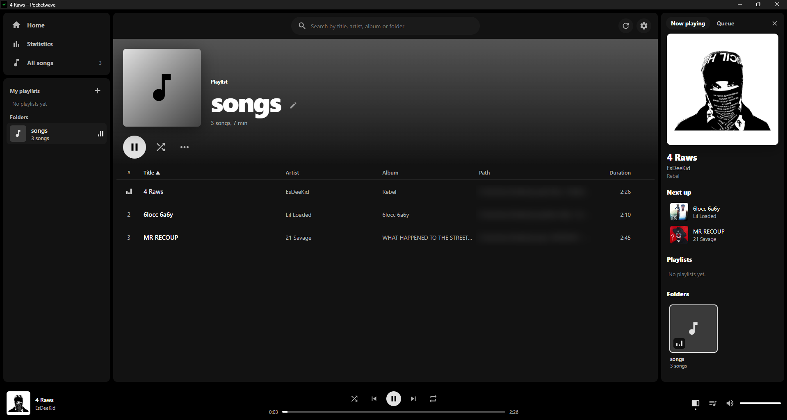
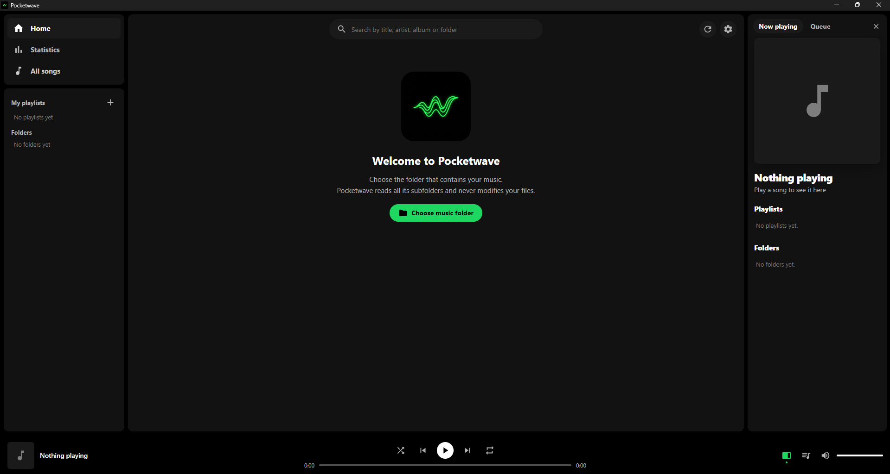
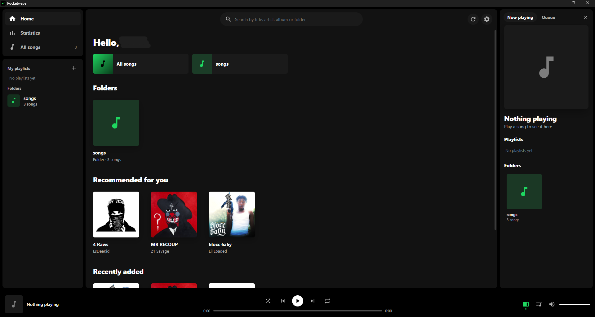
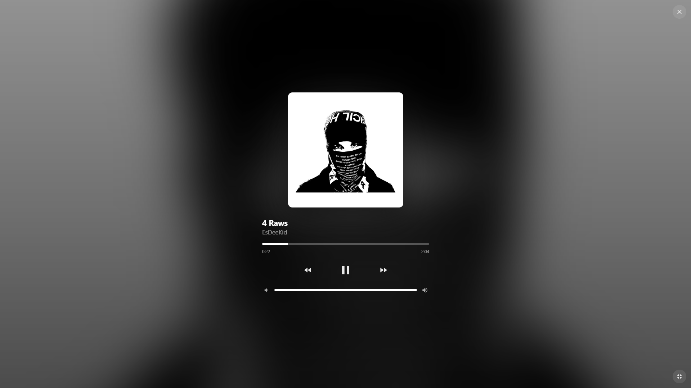
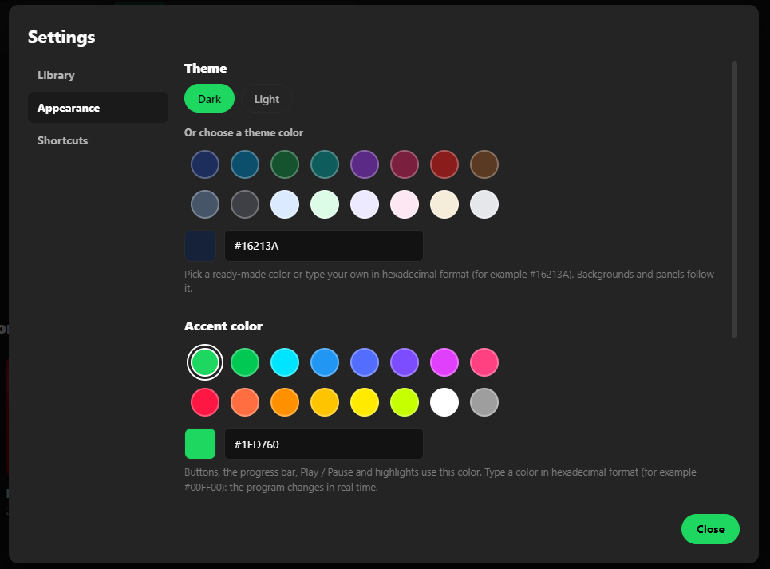

<p align="center">
  
</p>

# Pocketwave Lite

**The classic, light edition of Pocketwave: a flat dark interface, fast and easy on memory.**

> **ONLINE version.** The components needed to build Pocketwave are downloaded during the installation (about 140 MB, first time only), so an Internet connection is required. The **OFFLINE** folder is the same program with a `components` folder that already contains everything.

<p align="center">
  
</p>
<p align="center">
  
  
</p>
<p align="center">
  
  
</p>

Pocketwave Lite is the standard edition. It uses flat, dark Spotify-style panels with no heavy visual effects, so it starts fast and uses the least memory: a good choice for older or low-end computers and for leaving the player open all day.

> Looking for the other edition? See the [main README](../README.md) for a comparison of **Lite** and **Liquid**.

## At a glance

| | |
|---|---|
| Platforms | Windows 10/11 (64-bit), Linux (x64, arm64), macOS 10.15+ (Intel, Apple Silicon) |
| RAM while running | about 270-300 MB |
| Disk (extracted program) | about 230 MB |
| Needs | Nothing: no installer, no account, no Internet |
| Data location | `PocketwaveData` folder next to the program |
| License | MIT |

## Installation: ONLINE version

This is the **ONLINE** folder. The components needed to build Pocketwave are **downloaded during the installation** (about 140 MB, only the first time), so an Internet connection is required. Pocketwave itself needs no installer: you build it once with one click and it becomes a portable program. Nothing is installed on your computer: the downloads are kept in a temporary folder that is removed at the end.

### What you need
- Windows 10 / 11 (64-bit), Linux (x64 or arm64) or macOS 10.15 or newer.
- An Internet connection the first time. The launcher downloads a portable Node.js (from nodejs.org, checked with its SHA-256), the project packages (registry.npmjs.org) and the Electron runtime (github.com). If you use a firewall or proxy, these sites must be reachable.
- About 500 MB of free disk space while building (about 230 MB remain at the end).

### Steps
1. Copy the whole **ONLINE** folder to the computer.
2. Open `Pocketwave-lite`.
3. Start the launcher of your system:

| System | Launcher | How to start it |
|---|---|---|
| **Windows** 10 / 11 (64-bit) | `Build-Pocketwave.bat` | Double-click it. If SmartScreen appears: *More info* → *Run anyway*. |
| **Linux** (x64 or arm64) | `Build-Pocketwave.sh` | In a terminal, in that folder: `bash Build-Pocketwave.sh` |
| **macOS** 10.15 or newer | `Build-Pocketwave.command` | Double-click it. If macOS blocks it: right-click → *Open* → *Open*. If it does not start, run `chmod +x Build-Pocketwave.command` in Terminal first. |

4. The **Pocketwave Build System** terminal opens and shows **Mode: Online**. Wait for the six phases (the download is in phases 1 to 4); Pocketwave starts by itself.
5. The finished program is the `Pocketwave-portable` folder. Starting the launcher again just opens it (no Internet needed from now on). You can keep only `Pocketwave-portable`; to rebuild, delete it and start the launcher again.

While it works, the launcher shows the **Pocketwave Build System**: the same terminal on Windows, Linux and macOS, with the project, the mode (**Offline** or **Online**), the current phase (1/6 to 6/6), a status line, a progress bar with the elapsed time and a log with a time for every step. The six phases are: checking the environment, project dependencies, Electron runtime, build, creating `Pocketwave-portable` and cleaning up. If something fails, the terminal stops, shows the error in red with the last lines of the log and a hint (for example to copy the whole Pocketwave folder again when `components` is incomplete).

### If something goes wrong
- **Red error with "Check your Internet connection and try again"**: check the connection, the firewall or proxy and the antivirus, then start the launcher again.
- **No Internet on that computer**: use the **OFFLINE** folder instead, which has everything included.

### Ready-made portable program
If the **Releases** page offers a ZIP for your system, extract the **whole** folder (a USB drive works too) and run `Pocketwave.exe` (Windows), `./Pocketwave` (Linux) or `Pocketwave.app` (macOS). The program is not digitally signed: on Windows use *More info* → *Run anyway*; on macOS use right-click → *Open* the first time.

### Notes for Linux and macOS

- **Linux** needs GTK 3, NSS and ALSA or PulseAudio. On Debian / Ubuntu: `sudo apt install libgtk-3-0 libnss3 libasound2`. Where Chromium's sandbox is not allowed for programs that are not installed (for example Ubuntu 24.04), the launcher starts Pocketwave with `--no-sandbox`.
- **macOS**: `PocketwaveData` is created next to `Pocketwave.app` (never inside it); keep the app in a folder you can write to, not `/Applications`. Keyboard media keys may need *System Settings → Privacy & Security → Accessibility*.

## Features

### Statistics
The **Statistics** button in the sidebar opens a Spotify-style summary of your listening: **total minutes listened**, time listened today, songs played, different songs and your daily listening streak, plus your **most played song, artist and album**, a chart of the **last 14 days** and your top songs, artists and albums. Time is counted only while a song really plays (pausing and skipping around do not count) and a play is counted after 30 seconds. Everything is stored locally in the Pocketwave data folder; **Reset statistics** at the bottom of the page clears it.

### Home page
Pocketwave opens on a Spotify-style Home page: a greeting, quick-access tiles (All songs and your latest playlists and folders) and rows of cards: **Recently played**, **Your playlists**, **Folders**, **Recommended for you** (a daily pick from your own library, computed locally) and **Recently added**. Hover a card and press Play to start it **without leaving Home**; click the name or the empty part of the card to open it. **The photo of a playlist or folder opens it with a double click only** (a single click on the photo does nothing, so it is never opened by mistake; Play works with a single click). The same applies to the tiles at the top and to the cards in the right side panel. The very first start shows a welcome screen to choose your music folder.

### Library and synchronization
- **Always-on sync.** The music folder is monitored in real time and the folder is the source of truth:
  - a file is added: it is loaded automatically;
  - a file is removed or moved outside the folder: it leaves the library and appears as **missing** (greyed out, with a "file not found" icon) in your playlists;
  - a file is renamed or moved inside the folder: title and path are updated everywhere, with no duplicates;
  - a file is edited: the change is detected.
- An optional **second synchronized folder** can be set in Settings.
- **All songs**, sortable by title, artist, album or duration; the sort is remembered per list.
- **Global search** (`Ctrl` + `F`) across songs, artists, albums, playlists and folders, whatever list is open. Everything typed is found in the title, artist, album, folder or file name, anywhere in the text; searching for an artist lists all of their songs (by album and track). Results are ordered by relevance (whole words and titles first) and can still be sorted from the column headers.
- **Search inside a playlist or folder:** each playlist and folder page has its own search box that looks only at the songs of that list (`Esc` clears it).
- A loading popup with progress the first time a folder is read.
- Music files are only **read**, never modified.

### Playlists and folders
- **Folder playlists:** one automatic playlist for every folder that directly contains songs, named after the sub-folder.
- **My playlists:** create your own, drag to reorder, pin to the top. A pinned item shows a pin symbol after its name.
- **Context menu** (right-click or the three dots): Play, Pin to top / Unpin, Move to playlist / Move to folders (folders only), Move up / down, Show folder path (folders only), Export as M3U8, Edit, Delete.
- **Edit** changes name and photo in one dialog.
- **Photos** for playlists and folders: double-click the photo to enlarge it; the camera button (or right click) uploads, changes or deletes it. **All songs** can have a photo too (shown on its page and on the Home tile). Photos are cropped and resized in a small editor (drag to move, slider or mouse wheel to resize), compressed (768 px square, WebP) and stored in `PocketwaveData/images`; the size before and after is shown.
- **Delete** asks for confirmation. A folder is only removed from Pocketwave, it stays on your computer and can be restored in Settings.
- **M3U / M3U8** import and export, with relative paths when possible.
- **Playlist page color from the photo.** When a playlist or folder has a photo, the header of its page takes the dominant color of that photo with a soft fade into the page, like Spotify. Black and white photos use their average color. It can be turned off in *Settings → Appearance*.

### Playback
- Double-click a song or playlist to play it. A playlist's Play button turns into Pause while it plays, and the active playlist is highlighted in the accent color with a small playing animation (it pauses with the music). After the app is reopened, the playlist of the restored song is highlighted too, and its Play button resumes that song.
- **Shuffle is remembered per playlist.** Clicking shuffle starts the playlist at once in random order and the choice survives a restart.
- **Repeat** (all / one) and **volume** (maximum by default, with mute).
- **Queue:** *Play next* and *Add to queue*, with a preview of the added song. Queued songs play when the current one ends or is skipped.
- **Resume on startup:** the last song played comes back at the exact point where you stopped, ready to continue with one click.
- **Media keys and system controls:** keyboard media keys (play/pause, next, previous, stop) and the operating system media controls work, also when Pocketwave is in the background.
- **Remaining time:** click the total time in the playback bar to show the time left (for example `-2:12`); click again to go back. The choice is remembered.

### Now playing screen
Double-click the cover in the right side panel to open a full-window music screen:

- the cover, enlarged, blurred and darkened, fills the window and cross-fades when the song changes;
- large, sharp, centered cover (slightly smaller while paused), with title and artist;
- interactive playback bar with elapsed and remaining time;
- previous, play / pause and next buttons;
- volume bar with a mute button;
- a full screen button in the bottom right corner (`Esc` goes back; this temporary full screen is never saved as the window state);
- the **X** button or `Esc` closes the screen.

Everything uses the existing player, so the player bar, the side panel and this screen always stay in sync.

### Interface
- **Right side panel** (open by default): cover, title and artist of the current song, the **next songs**, then your playlists and folders with their photos. It also holds the queue. Drag its header to dock it on the other side; drag its edge to resize it.
- **Resizable left sidebar.** At minimum width it collapses to icons only.
- **Remembered layout:** window size, position and state (normal, maximized, full screen), sidebar width and panel width are restored at the next start. Default window: 1280 × 720, reduced with the same proportions on small screens.
- Top bar: search in the center, *Refresh* and *Settings* on the right. Bottom right: panel button, queue button, volume.
- Progress and volume bars are white (dark in light themes) and take the accent color when the pointer is over them. The Play / Pause button is white at default settings and takes your accent color as soon as you choose one.

### Settings
- **Library:** music folder with *Browse*, data folder with *Change folder*, *Refresh library*, *Reset*, extra synchronized folder, playlist import, options (extract covers from tags, read ID3 metadata), photo manager and restore of removed folders.
- **Appearance:**
  - **Theme:** dark (default), light, or any **theme color** from a ready-made palette or your own hexadecimal color (for example `#16213A`); backgrounds and panels follow it.
  - **Accent color:** palette or hexadecimal field (for example `#00FF00`) with live preview and a reset to green.
  - **Dynamic color:** optionally use the dominant color of the album cover as the accent. White, black or grey covers give a matching neutral (near white or soft grey) instead of a color.
  - **Playlist page color from its photo:** the page header takes the dominant color of the playlist photo (on by default).
- **Shortcuts:** editable table with a reset to defaults.

## Supported audio formats

MP3, WAV, FLAC, OGG, AAC, M4A and OPUS. **WMA is not supported** (the playback engine does not handle it). Title, artist, album, track number and embedded cover are read from the tags.

## Keyboard shortcuts

| Action | Key |
|---|---|
| Play / Pause | `Space` |
| Next / previous song | `Ctrl` + `→` / `Ctrl` + `←` |
| Volume up / down | `Ctrl` + `↑` / `Ctrl` + `↓` |
| Seek forward / back 5 s | `→` / `←` |
| Search | `Ctrl` + `F` |
| Show / hide side panel | `Ctrl` + `I` |
| Open queue | `Ctrl` + `Q` |

## Your data

Every change is saved as JSON in the `PocketwaveData` folder next to `Pocketwave.exe` (or the Linux / macOS program):

| File | Content |
|---|---|
| `userdata.json` | playlists, order, pins, folders moved to *My playlists*, per-playlist shuffle, settings, colors, shortcuts, recently played, last position, sidebar and panel layout |
| `window-state.json` | window size, position and state |
| `library.json` | library cache for fast starts |
| `images/` | compressed photos of playlists and folders |

To move the program, copy the whole folder, `PocketwaveData` included. If the folder is not writable, Pocketwave asks where to save its data. If your music moves to another drive, choose the new folder in Settings: playlists follow it automatically.

## Privacy

No backend, no accounts, no analytics, no telemetry, no ads, no network requests. A strict content security policy prevents the interface from loading anything from the network, and the window runs with context isolation and the Chromium sandbox. The greeting on Home uses your operating system user name, read locally; it is only shown on screen and never saved or sent. Deleting the program folder removes everything Pocketwave ever saved.

## Development

Requires Node.js 18 or newer.

```bash
npm install
npm start                 # run in development mode
npm run build:win         # portable Windows x64 build in dist/
npm run build:linux       # portable Linux build for this processor
npm run build:mac         # portable macOS build for this processor
npm run build:win:latest  # same as build:win, with a newer Electron (larger)
```

The build produces a self-contained folder (Electron runtime included), embeds `assets/icon.ico` into `Pocketwave.exe` and prints the extracted size at the end.

### Project structure

```
Pocketwave-lite/
├─ assets/
│  ├─ icon.ico              Windows icon (embedded in Pocketwave.exe by the build)
│  ├─ icon.png              Linux window icon (logo on a black background)
│  └─ logo.png              Logo without background, shown inside the app (welcome screen)
├─ scripts/
│  ├─ build.js              portable build for Windows, Linux and macOS
│  ├─ build-system.js       the Pocketwave Build System terminal (phases, progress bar, log)
│  ├─ build-unix.sh         used by the Linux and macOS launchers
│  ├─ offline-prepare.js    offline build: verifies and joins the Electron parts of ../components
│  └─ download-node.ps1     downloads a portable Node.js for the .bat
├─ src/
│  ├─ main/                 Electron main process
│  │  ├─ main.js            window and its saved state, data saving, photos, M3U, folder monitoring, media keys, IPC
│  │  ├─ preload.js         secure bridge to the interface
│  │  └─ scanner.js         read-only scanning, metadata, covers
│  └─ renderer/             interface
│     ├─ index.html
│     ├─ styles/app.css
│     └─ scripts/
│        ├─ core.js         helpers, icons, theme and accent colors, shortcuts, state
│        ├─ library.js      library, lists, playlists and folders, menus, search
│        ├─ player.js       playback, queue, side panel, Now playing screen, Home
│        └─ app.js          startup, settings, dialogs, window layout
├─ Build-Pocketwave.bat         one-click build and launcher for Windows
├─ Build-Pocketwave.sh          one-click build and launcher for Linux
├─ Build-Pocketwave.command     one-click build and launcher for macOS
├─ package.json
└─ package-lock.json
```


## Size and optimization

Almost all of the size is the Electron runtime (the Chromium engine that draws the interface); the Pocketwave code itself is under 3 MB. The build keeps the program small:

1. a compact Electron version (the biggest saving);
2. only the English locale file;
3. the DirectX shader compiler (`dxcompiler.dll`, `dxil.dll`) removed, since Pocketwave does not use WebGPU;
4. the code packed in a single `asar` archive, with production dependencies only.

Further options, not applied by default: removing `vk_swiftshader.dll` and `vulkan-1.dll` (about 6 MB, but computers without a usable graphics driver may fail to open the window) or `d3dcompiler_47.dll` (about 5 MB, test before shipping). Do not use executable packers such as UPX: they slow startup and often trigger antivirus false positives. A 7z / xz archive of the folder is roughly 100 MB.

**Security note.** The default build uses an older Electron that no longer receives new Chromium security fixes. The risk is limited because Pocketwave never loads remote content (strict content security policy, sandbox, context isolation, no network access), but a maliciously crafted audio or image file could still target the media decoders. If you open files from untrusted sources, build with `npm run build:win:latest`.

## Features intentionally not included

To keep the player simple and reliable: audio output device selection, equalizer, ReplayGain, crossfade, gapless playback, playback speed, duplicate detection, shortcut export / import, "follow system theme", favorites, bookmarks and history.

## License

Released under the **MIT** license (see [`LICENSE`](../LICENSE)). Third-party components (Electron, Chromium, music-metadata) keep their own licenses, listed in `licenses/THIRD-PARTY-NOTICES.txt` inside the built program. The icon in `assets` is part of the Pocketwave brand; if you fork the project under another name, please replace it.
