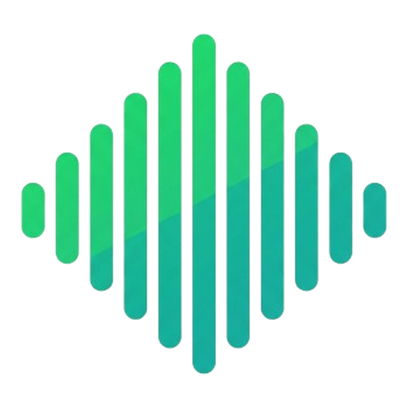
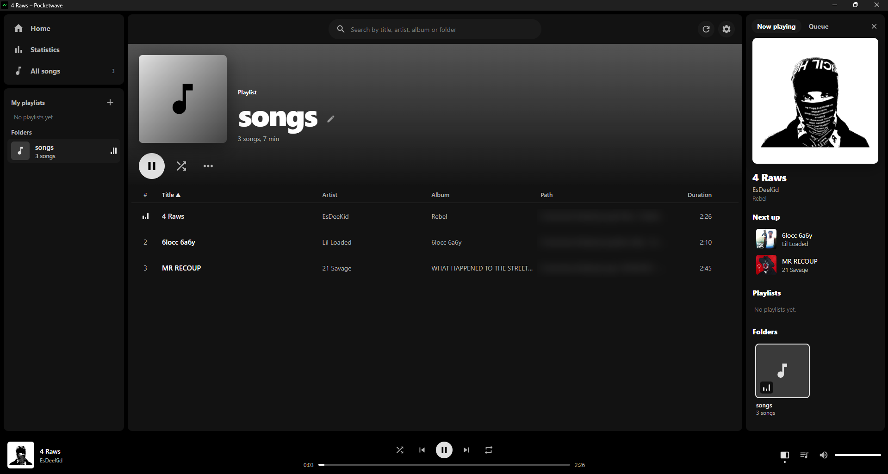
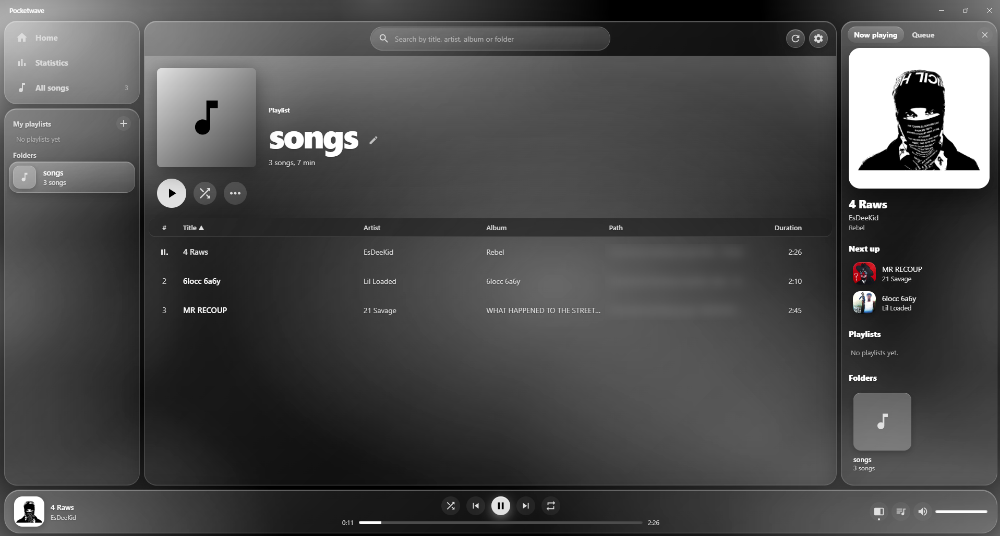

<p align="center">
  
</p>

# Pocketwave

**A portable, offline music player for Windows, Linux and macOS, with a Spotify-inspired interface.**

Point it at a folder of music and play. No installer, no account, no Internet connection, no telemetry. Everything Pocketwave saves stays in one folder next to the program.

<p align="center">
  
  
</p>
<p align="center"><sub>Left: <b>Pocketwave Lite</b> &nbsp;·&nbsp; Right: <b>Pocketwave Liquid</b></sub></p>

## Choose your version

This repository contains two editions of the same player. They share the same features, data format and build process; they differ in how the interface is drawn.

| | [**Pocketwave Lite**](Pocketwave-lite) | [**Pocketwave Liquid**](Pocketwave-liquid) |
|---|---|---|
| Look | Classic dark, flat Spotify-style panels | *Liquid glass*: translucent, blurred panels over a living, colored background |
| RAM while running | about 270-300 MB | about 300-600 MB |
| Disk (extracted program) | about 230 MB | about 230 MB |
| Playlist page color taken from its photo | Yes | No |
| Background colors (automatic or your own, 1-5) | - | Yes |
| Graphics quality presets (from Minimum to Maximum) | - | Yes |
| Best for | Older or low-end computers, long listening sessions | Modern computers, a more visual look |
| Folder | `Pocketwave-lite/` | `Pocketwave-liquid/` |

Not sure? Start with **Lite**. If you like the glass look and your computer is recent, try **Liquid**. You can keep both: they are independent and do not share data unless you point them to the same data folder.

The source code of both editions together is only about 500 KB as a ZIP. The portable program is built from it with one click (see below).

## Highlights

- **Portable and offline.** Copy the folder to a USB drive and run it anywhere. Nothing is installed, and the app never connects to the Internet.
- **Your music stays untouched.** Files are only read: never renamed, moved, deleted or modified.
- **Live folder sync.** Add, rename, move or delete files while the app is open and the library updates by itself. Missing songs show up greyed out in playlists instead of breaking them.
- **Home page.** Greeting, quick-access tiles, recently played, folders, a daily pick from your own library and recently added songs.
- **Statistics.** A Spotify-style page with your total minutes listened, most played song, artist and album, the last 14 days and your top songs. Collected and kept only on your computer.
- **Playlists your way.** Folder playlists are created automatically; make your own, pin, reorder, add photos, import and export M3U / M3U8.
- **Great playback controls.** Queue, per-playlist shuffle, repeat, resume where you stopped, keyboard media keys and system media controls.
- **Full-window Now playing screen** with a blurred cover background.
- **Customizable.** Dark, light or any theme color; any accent color (or one taken from the album cover); editable keyboard shortcuts.
- **Cross-platform.** Windows 10/11 (64-bit), Linux (x64 and arm64) and macOS 10.15 or newer (Intel and Apple Silicon).

## Installation

Pocketwave needs no installer. Pick one of the two ways below.

### Option 1: one-click build (recommended, all systems)

You do **not** need Node.js or any other tool. The launcher downloads a portable one, builds Pocketwave, creates a `Pocketwave-portable` folder and starts the program. An Internet connection is required the first time only (about 140 MB are downloaded; temporary files are removed at the end). The first build takes about 5 minutes.

1. On GitHub choose **Code → Download ZIP** and extract it.
2. Open the folder of the version you want: `Pocketwave-lite` or `Pocketwave-liquid`.
3. Start the launcher of your system:

| System | Launcher | How to start it |
|---|---|---|
| **Windows** 10 / 11 (64-bit) | `Build-Pocketwave.bat` | Double-click it. If SmartScreen appears: *More info* → *Run anyway*. |
| **Linux** (x64 or arm64) | `Build-Pocketwave.sh` | In a terminal, in that folder: `bash Build-Pocketwave.sh` |
| **macOS** 10.15 or newer | `Build-Pocketwave.command` | Double-click it. If macOS blocks it: right-click → *Open* → *Open*. If it does not start, run `chmod +x Build-Pocketwave.command` in Terminal first. |

Next time, starting the same launcher simply opens Pocketwave. The finished program is in `Pocketwave-portable`: you can keep only that folder and delete the rest. To rebuild, delete `Pocketwave-portable` and start the launcher again.

### Option 2: ready-made portable program

If the **Releases** page offers a ZIP for your system, download it, extract the **whole** folder (a USB drive works too) and run:

- **Windows:** `Pocketwave.exe` (SmartScreen: *More info* → *Run anyway*; the program is not digitally signed).
- **Linux:** `./Pocketwave`
- **macOS:** open `Pocketwave.app` (first time: right-click → *Open*, because it is not signed by Apple).

### Notes for Linux and macOS

- **Linux** needs a desktop with the usual libraries (GTK 3, NSS, ALSA or PulseAudio). On Debian / Ubuntu: `sudo apt install libgtk-3-0 libnss3 libasound2`. On systems that do not allow Chromium's sandbox for programs that are not installed (for example Ubuntu 24.04), the launcher starts Pocketwave with `--no-sandbox`.
- **macOS:** the data folder `PocketwaveData` is created next to `Pocketwave.app`, so keep the app in a folder you can write to (not `/Applications`). Keyboard media keys may need *System Settings → Privacy & Security → Accessibility*.

## Getting started

1. Start Pocketwave and click **Choose music folder**. Pocketwave reads all its subfolders.
2. A popup shows the loading progress. From the second start on, Pocketwave opens straight to the Home page.
3. Double-click a song or a playlist to play it.

## Supported audio formats

MP3, WAV, FLAC, OGG, AAC, M4A and OPUS. **WMA is not supported.** Title, artist, album, track number and embedded cover are read from the tags; `cover`, `folder` or `front` `.jpg` / `.png` images are used when a song has no embedded cover.

## Keyboard shortcuts

All shortcuts can be changed in *Settings → Shortcuts*.

| Action | Key |
|---|---|
| Play / Pause | `Space` |
| Next / previous song | `Ctrl` + `→` / `Ctrl` + `←` |
| Volume up / down | `Ctrl` + `↑` / `Ctrl` + `↓` |
| Seek forward / back 5 s | `→` / `←` |
| Search | `Ctrl` + `F` |
| Show / hide side panel | `Ctrl` + `I` |
| Open queue | `Ctrl` + `Q` |

## Privacy

- No backend: no server, no API, no remote database.
- No accounts, analytics, telemetry or ads. The interface is locked down with a strict content security policy, so it cannot load anything from the network.
- The Home greeting uses your operating system user name, read locally. It is only shown on screen and is never saved or sent anywhere.
- All data (playlists, settings, photos, recently played, window layout) is stored as JSON in a `PocketwaveData` folder next to the program. If that folder is read-only, Pocketwave asks for another place and remembers the choice in one small file in your user profile.
- Deleting the program folder (and that file, if it exists) removes everything Pocketwave ever saved.

## Repository structure

```
Pocketwave/
├─ images/            logo and screenshots used in the READMEs
├─ Pocketwave-lite/       Pocketwave Lite: full project and build launchers
├─ Pocketwave-liquid/     Pocketwave Liquid: full project and build launchers
├─ LICENSE
└─ README.md
```

Each edition has its own detailed README with features, project structure and build commands:

- [Pocketwave Lite README](Pocketwave-lite/README.md)
- [Pocketwave Liquid README](Pocketwave-liquid/README.md)

## Built with

Electron, JavaScript / HTML / CSS and [`music-metadata`](https://github.com/Borewit/music-metadata) for tags. No front-end framework, no server.

## License

Released under the **MIT** license (see [`LICENSE`](LICENSE)). Third-party components (Electron, Chromium, music-metadata) keep their own licenses, listed in `licenses/THIRD-PARTY-NOTICES.txt` inside the built program.

The icon in `assets` is part of the Pocketwave brand. The MIT license covers the code; if you fork the project and publish it under another name, please replace the icon.
